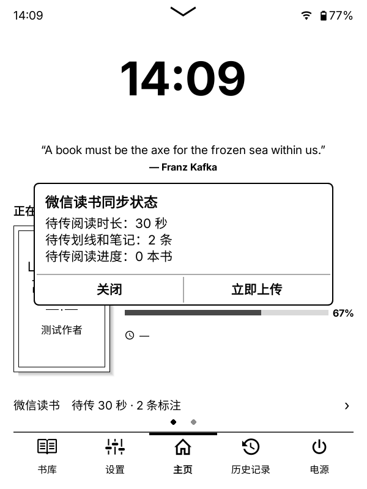

# 微信读书 KOReader 插件 · kevin 维护版

> **免责声明**：本项目仅供个人学习和技术研究使用，不得用于商业用途。使用本项目所产生的一切后果（包括但不限于账号封禁、数据丢失等）由使用者自行承担，项目作者概不负责。请遵守微信读书的用户协议和相关法律法规。

在 KOReader 上阅读微信读书书籍、公众号文章的开源插件。支持分组书架、章节与全书下载、进度同步、阅读时长上报与统计；本地书也可关联微信读书书目，匹配查看划线和想法。让 Kindle、Kobo 等设备也能体验微信读书！

本分支由 **kevin**（GitHub 账号 `lonelygo`）维护，基于 **finlater** 的开源版 v1.7.1。上游作者的闭源版与本分支分别发布。[上游开源项目与版本说明](https://github.com/finlater/weread.koplugin/tree/v1.7.1)

## 离线阅读

- 在 **设置 → 下载设置 → 章节预下载** 启用下一章预下载，打开普通微信读书书籍的第一章即可开始阅读。已下载的章节共用一个 EPUB 入口。翻到末页时，插件会接上缓存的下一章；离线时可从微信读书的章节列表返回已缓存章节。若从中间起读后补前章，插件目录仍按原书顺序显示，KOReader 原生目录会反映实际追加顺序，以保留已有笔记的位置。整书下载仍可单独使用。
- 需要累计时长时，在 **阅读时间上报** 启用上报，并在目标书籍中选择 **自动关联微信读书书籍**。需要同步进度时，在 **设置 → 进度管理** 启用关书上传。KOReader 运行并重新联网后，插件按当前登录账号处理积存记录。
- 在插件下载的书上使用 KOReader 原生划线和笔记。**离线同步** 可以查看待传记录，也可以关闭新标注的自动同步。文字笔记以私密想法提交。旧版下载缺少原文版本信息时，重新下载相应章节可建立匹配依据。无法唯一定位的选区会留在本机。

## 安装

> ⚠️ 建议使用 **KOReader 2026.03 或更高版本**。旧版本可能无法正常加载或使用插件，例如「工具」菜单中找不到「微信读书」。详见 [#14](https://github.com/finlater/weread.koplugin/issues/14)。

1. 前往 [GitHub Releases](https://github.com/lonelygo/weread.koplugin/releases/latest) 下载最新的 `weread.koplugin-vX.Y.Z.zip` 安装包。
2. 解压安装包，得到 `weread.koplugin` 文件夹。
3. 将该文件夹复制到 KOReader 的 `plugins` 目录：

```
koreader/plugins/weread.koplugin/
```

4. 重启 KOReader，在菜单中找到：

```
工具 → 微信读书
```

从上游版切换时，请先按上述步骤手动安装一次。之后在 **微信读书 → 设置 → 关于 → 检查更新** 获取 kevin 的新版本，也可在同一处打开每小时自动检查。

## 登录与认证

插件只支持微信扫码登录，扫码前需要先为账号开通微信读书 Skill：

1. 手机打开**微信读书 App**。
2. 进入 **我 → 设置 → 微信读书 Skill**。
3. 点击 **获取 API Key**，确认已经生成个人官方 API Key。
4. 在 KOReader 打开 **工具 → 微信读书 → 微信扫码登录**。
5. 使用微信扫码并在手机端确认；若手机显示四位验证码，请在 KOReader 中输入。

## 功能

| 主菜单 | 书架 | 公众号 |
|:---:|:---:|:---:|
|  |  |  |

| 阅读时间上报 | 阅读统计 | 阅读进度同步 |
|:---:|:---:|:---:|
|  |  |  |

| 多选章节下载 | 章节预下载 | 下载全书 |
|:---:|:---:|:---:|
|  |  |  |

| 书籍详情 | 书评 | 划线和想法 |
|:---:|:---:|:---:|
|  |  |  |

| 搜索书籍 | 快捷菜单 | 设置 |
|:---:|:---:|:---:|
|  |  |  |


## SimpleUI / Zen_UI 集成

**SimpleUI 首页同步状态。** 在 SimpleUI 3.1.0 上，升级并重启 KOReader 后，插件首次会在「正在阅读」书卡所在行的下方加入「微信读书同步状态」。点书卡继续阅读，点状态行可在小弹窗里查看本机待传的进度、阅读时长、划线和私密笔记。查看详情可以离线完成。从 v1.8.4 起，点弹窗底部的「立即上传」即可发起同步，点「关闭」直接回到首页。

有记录待传时会显示「待传 8 分钟 · 2 条标注」。需要选择阅读进度或核对上报结果时，首页会优先提示。本轮待办全部获确认后显示「已同步」和确认时间。首次使用或从旧版升级时，空队列显示「暂无待传记录」。

在 SimpleUI 的 **设置 → 主页 → 编辑主页布局** 中，可以移动或移除状态行。首页没有启用「正在阅读」时，也可在这里选择 **添加模块 → 附加功能 → 微信读书同步状态** 放到喜欢的位置。原生 KOReader 可通过 **工具 → 微信读书 → 离线同步 → 同步状态** 查看同一份详情。[SimpleUI 首页布局说明](https://github.com/doctorhetfield-cmd/simpleui.koplugin/blob/3.1.0/docs/HOME_SCREEN.md)

| 书卡下方的同步状态 | 点开后的详情 |
| --- | --- |
|  |  |

- **SimpleUI 书架快捷按钮**：进入 `快捷操作` 新建操作，类型选择 `插件 → 微信读书`，再把该操作加入底部栏即可。如需使用本项目图标，将 `icons/weread-w-book.svg` 或 `icons/weread-ink.png` 复制到 SimpleUI 的自定义图标目录`koreader/setting/simpleui/sui_icons`后，在快捷操作中选中它。
- **Zen_UI 底栏**：进入 `控件 → 按钮 → ➕ → 插件 → 微信读书`，点击后直接打开微信读书书架。注册时会把 `weread-w-book.svg` 同步到 KOReader 用户图标目录，供 ZenUI 自动匹配或手动选择；不会自动修改、添加或启用 Tab。
- **Zen_UI 首页**：进入 `主页 → 小组件`，启用“微信读书”组件。组件默认关闭，可由用户自行排序。

原生 KOReader 的 “工具 → 微信读书” 菜单保持不变。

|                     SimpleUI                     |                   Zen_UI                   |
|:------------------------------------------------:|:------------------------------------------:|
|  |  |

## 菜单结构

```
微信读书
├── 书架               单行顶栏：内容与分组 / 搜索 / 获取最新 / 菜单
│   ├── 内容与分组      书籍 / 公众号；书籍内选择微信读书分组，支持离线缓存
│   └── 菜单            排序、筛选、列表 / 封面；列表支持分页 / 连续滚动，分页支持滑动与按钮
├── 微信扫码登录 / 已经登录 · 账号名
├── 立即同步进度       （阅读微信读书缓存书籍时显示）
├── 书籍详情           （阅读微信读书缓存书籍时显示）
├── 显示划线和想法     （阅读书籍时显示，开关）
├── 划线和想法管理     （本地书与微信下载书共用；不修改 EPUB/KOReader 笔记）
│   ├── 匹配微信读书书目 / 已关联微信书籍：书名（下载书自动关联）
│   ├── 继续匹配（手动续传、定位；开书仅显示已保存结果）
│   ├── 选择章节匹配（完整本地目录，可手动对应；勾选章节获取最新想法）
│   └── 清理划线和想法（再次匹配时下载最新数据）
├── weread收藏夹        已下载书籍（不包含单章）的本地入口
├── 搜索               搜索微信读书
├── 离线同步            查看待传时长与标注、设置新划线和私密笔记同步
├── 阅读时间上报        后台上报阅读时长
│   ├── 启用阅读时间上报
│   ├── 仅在阅读时上报
│   ├── 上报间隔
│   │   ├── 30 秒（默认）
│   │   └── 60 秒
│   ├── 选择目标书籍
│   │   ├── 自动关联微信读书书籍
│   │   └── 手动设置上报书籍
│   └── 上报状态
├── 阅读统计            阅读时长/天数/排行/偏好可视化（页内 周/月/年/总 tab 切换，可翻阅历史周期）
├── 设置
│   ├── 书架视图
│   │   ├── 列表模式（默认；适合连续滚动）
│   │   └── 封面模式（按屏幕自适应行列；仅加载当前页封面）
│   ├── 分页书架（仅列表模式；默认开启，关闭后使用连续滚动）
│   ├── 缓存管理
│   │   ├── 扫描并关联本地书籍
│   │   ├── 缓存清理
│   │   └── 缓存目录
│   ├── 进度管理
│   │   ├── 打开时拉取进度（默认关闭）
│   │   └── 关闭时上传进度（默认关闭）
│   ├── 下载设置
│   │   ├── 书籍图片（默认开启）
│   │   ├── 公众号文章图片（默认关闭）
│   │   ├── 隐藏脚注文本（默认关闭；开启需同时启用 KOReader 脚注弹框；仅影响新下载书籍）
│   │   └── 章节预下载
│   │       ├── 自动预下载下一章（默认关闭，后台下载）
│   │       ├── 预下载划线和想法（默认关闭；需同时开启总开关，位置匹配仍手动触发）
│   │       └── 显示预下载提示（默认开启，总开关关闭时不可操作）
│   ├── 划线设置
│   │   ├── 划线边缘防误触（默认开启）
│   │   ├── 边缘区域：20%（可调 10%–40%）
│   │   └── 想法弹窗设置
│   │       ├── 位置：居中（可切换为 底部）
│   │       ├── 高度：62%（可调 20%–90%）
│   │       ├── 宽度：80%（仅居中时可用，40%–100%）
│   │       ├── 字体大小（相对文档字号，默认 -2；可切换为绝对字号）
│   │       ├── 字体对比度：默认（可调 -3–+9，最大为纯黑）
│   │       └── 点击左右区域翻页（默认关闭，底部与居中弹窗均生效）
│   │   └── 想法弹窗宽度：80%（仅居中时可用，40%–100%）
│   ├── 账号管理
│   │   ├── 账号状态
│   │   ├── 立即续期 Cookie
│   │   └── 清除账号数据
│   ├── 高级选项
│   │   └── Mock 服务
│   │       ├── 当前生效环境
│   │       ├── 重启后启用 Mock（默认关闭，测试数据独立保存）
│   │       ├── 服务器 IP：192.168.31.111（可修改）
│   │       ├── 服务器端口：8765（可修改）
│   │       └── 测试连接
│   └── 关于
│       ├── 版本 x.y.z
│       ├── 分支维护者：kevin（上游原作者 finlater）
│       ├── 上游作者的闭源版
│       ├── 检查更新
│       ├── 每小时自动检查一次（默认关闭）
│       └── 更新时优先使用代理（默认开启；代理失败会自动回退 GitHub）
```

## 贡献

欢迎提交 issue 和 PR。提交前请阅读 [CONTRIBUTING.md](CONTRIBUTING.md)。

XPointer 外部标注层仍是实验性功能，测试步骤和限制见
[原型说明](docs/xpointer-overlay-prototype.md)。

## 许可证

本项目代码采用 [GNU Affero General Public License v3.0](LICENSE)，SPDX 标识为 `AGPL-3.0-only`，与 KOReader 使用的许可证保持一致。

修改、整合或再分发本项目时，必须遵守 AGPL-3.0，保留版权和许可证声明，并按许可证要求将本项目代码或其衍生作品开源。

`fonts/NotoEmoji-Regular.ttf` 是第三方字体，采用 [SIL Open Font License 1.1](fonts/LICENSE)，不适用本项目的 AGPL-3.0。

Copyright © 2026 finlater and contributors. Fork modifications © 2026 kevin and contributors.

## 项目推荐

| 插件 | 简介                                                  |
|------|-----------------------------------------------------|
| [kindlebtcontroller.koplugin](https://github.com/finlater/kindlebtcontroller.koplugin) | 蓝牙手柄/遥控器控制 Kindle —— 翻页、调节亮度、章节跳转等 20+ 操作，按键完全可自定义。 |
| [one.koplugin](https://github.com/finlater/one.koplugin) | 在 KOReader 上离线阅读「ONE · 一个」每日更新：一图、一文、一问答。           |
